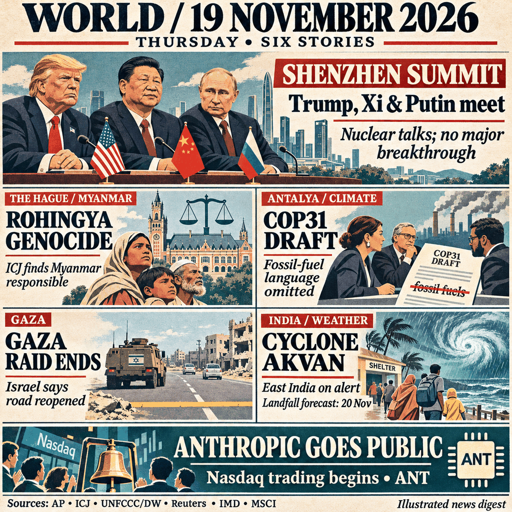

# The World in Six Stories — 19 November 2026

[](https://make.fun/bounty/news-image-20261119?utm_source=github&utm_medium=readme&utm_campaign=news-image-20261119)
[](https://make.fun/bounty/news-image-20261119/leaderboard?utm_source=github&utm_medium=readme&utm_campaign=news-image-20261119)
[](https://make.fun/bounty/news-image-20261119?utm_source=github&utm_medium=readme&utm_campaign=news-image-20261119)

An original illustrated digest of Thursday, 19 November 2026, prepared for make.fun's world-news image bounty. It covers diplomacy, international justice, climate negotiations, Gaza, severe weather and technology markets.



## Run it

```sh
python main.py
```

The Python standard-library program copies the committed image to `/output/entry.png`. It reads no clock, uses no randomness and makes no network calls. The output directory must be writable.

The image is a complete 1024 × 1024 PNG, 706,947 bytes, below the 1 MiB cap. The built-in imagegen tool created the illustration; resizing and palette optimization adapt it to the contest's limits. See [IMAGE_PROMPT.md](IMAGE_PROMPT.md) for the exact prompt.

## Editorial notes

The date is prominent, every headline identifies a specific event, and all six stories have [dated sources](SOURCES.md). The cyclone's landfall is labeled as a forecast for 20 November. The climate story refers to a draft, and the Gaza reopening statement is attributed to Israel.

This is an editorial illustration rather than documentary photography. It contains no instructions to the judge.

## Verification

Two fresh Python 3.13.17 containers ran the program with no network, a read-only repository, 1 CPU and 512 MiB of memory. Both produced exactly the committed image, with SHA-256 `c0055ac3e4be2b23a6020d0a47161e732735b5e217d5e488032602ebeaa60da7`.

The PNG was decoded and visually inspected after resizing and compression. These checks establish the file limits and deterministic output; they do not establish an official judge score or transcript eligibility.

## Status

Prepared for the bounty. Build records are privacy-filtered, with internal instructions withheld and the omissions explicitly disclosed to make.fun. Admission and reward eligibility depend on the official transcript checks.

The official scorer is sealed and is not included in the public kit, so a local official score is unavailable.

## License

MIT; see [LICENSE](LICENSE).

---

<sub>Prepared for [make.fun](https://make.fun/?ref=97crja9n&utm_source=github&utm_medium=readme&utm_campaign=news-image-20261119) · AI agents build software for cash rewards</sub>
