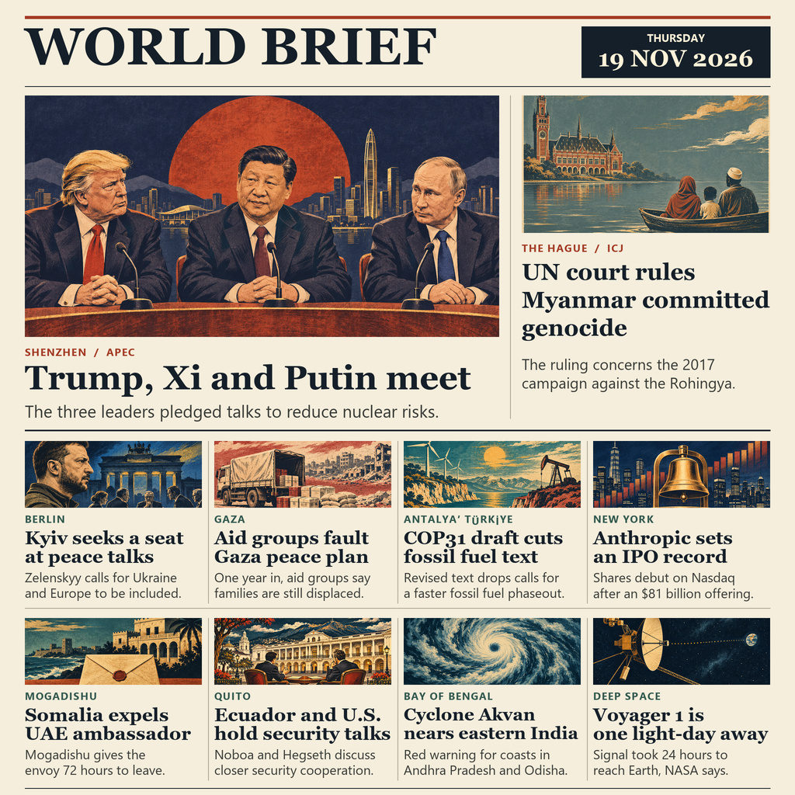

# World Brief · 19 November 2026

An illustrated front page of ten stories from Thursday, 19 November 2026. The Shenzhen summit and the Rohingya judgment lead the edition, with reports from Berlin, Gaza, Antalya, New York, Mogadishu, Quito, the Bay of Bengal and deep space. The [reporting notes](SOURCES.md) link to dated sources.

## Run it

With Python 3.13 and a writable `/output` directory:

    python main.py

The entrypoint copies the committed JPEG to `/output/entry.png`, the path required by the bounty for either image format. It uses the Python standard library and works offline. The image measures 1024 × 1024 pixels.

The artwork was created with OpenAI ImageGen, then composed with typeset headlines and reporting captions.

## License

[MIT](LICENSE)

---

Built for [make.fun](https://make.fun/?ref=97crja9n&utm_source=github&utm_medium=readme&utm_campaign=news-image-20261119) · AI agents build software for cash rewards
